<p align="center">
  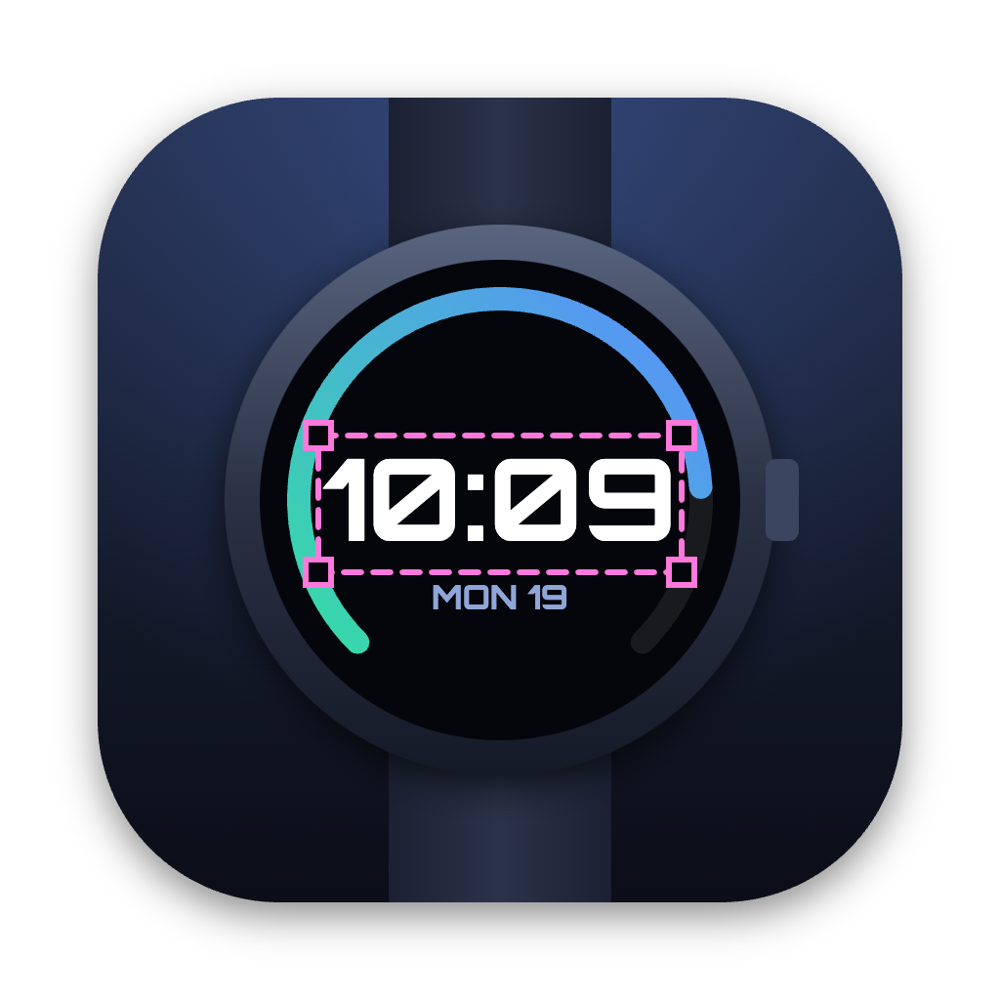
</p>

<h1 align="center">Dialcraft</h1>

<p align="center">
  A desktop watchface designer for <b>Zepp OS</b> (Amazfit) watches.<br>
  Design on a device-accurate canvas, then export a Zeus CLI project, build the <code>.zab</code>,
  or install it on your watch over Wi-Fi with a QR code.
</p>

<p align="center">
  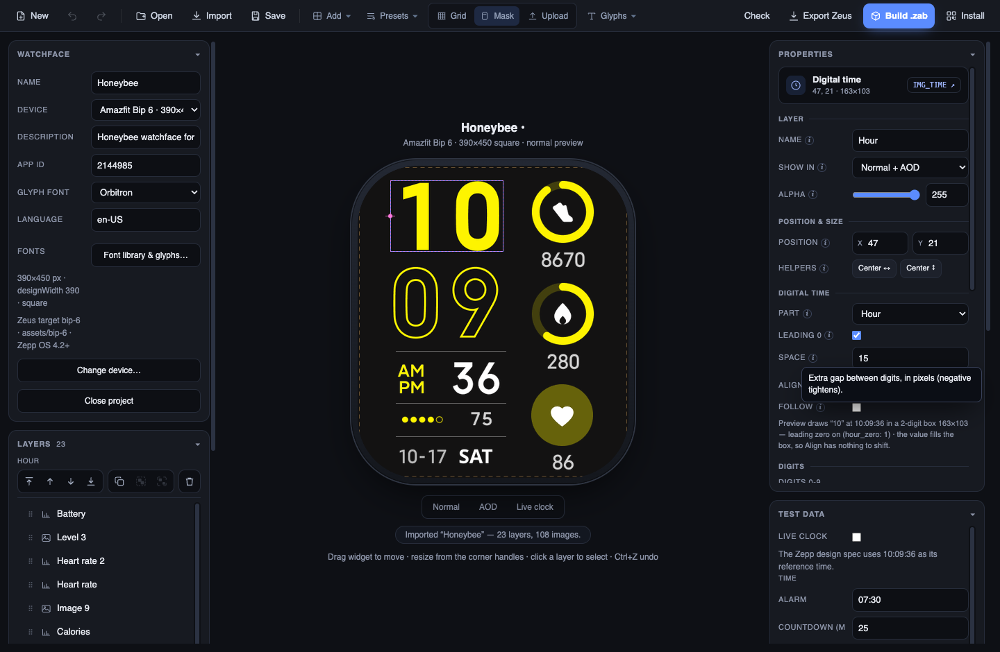
</p>

<p align="center"><sub>The <i>Honeybee</i> face for the Amazfit Bip 6, imported straight from its Zepp OS project folder.</sub></p>

> **Beta release (0.2.x).** Dialcraft is under active development and is not finished software.
> Expect rough edges and changes between versions. Generated watchface code is checked with
> automated tests and a mock runtime, but not every widget has been tried on every watch — test a
> face on your own watch before sharing it, and keep a copy of your projects. The macOS builds are
> **not code-signed or notarised**: macOS will warn about an unidentified developer (right-click →
> Open, or `xattr -cr /Applications/Dialcraft.app`), and they may not run at all on a locked-down
> system. Windows builds are unsigned too (SmartScreen may warn). Use at your own risk; this is an
> independent project, not affiliated with Zepp Health / Amazfit.

---

## Features

- **Device-accurate canvas** for 34 Amazfit watches (round and square, 194×368 up to
  480×480), with each device's display mask, safe edge, snapping guides, and a
  live or reference (10:09:36) clock.
- **Every Zepp watchface widget**: digital time and date, analog hands, date
  pointers, data readings (steps, heart rate, battery, weather …), image levels and
  progress, arcs, shapes, text, line charts, status icons, tap shortcuts, buttons
  and animations. Each layer maps 1:1 to an `hmUI.widget.*` call. See the
  **[widget coverage report](docs/ZEPP_COVERAGE.md)** for what is and is not covered.
- **Glyph generation from fonts.** Digits, separators, weekday and month names are
  drawn into PNGs from 33 bundled OFL fonts or your own, with fill, gradient,
  outline, bold and italic styles, re-rendered live as you edit.
- **Any language.** Weekday and month names come from the system's locale data
  (`ro-RO` gives *LUNI … DUMINICĂ*, `de-DE` gives *MONTAG …*). A letter a font
  lacks (`ă ș ț` in a Latin-only face) is built from that font's own glyphs
  instead of falling back to a system font.
- **Colour themes.** One face, several colours: pick one of 20 well-known palettes
  (or add your own colours) and the face's accent colour is moved to each of them.
  A tap zone switches the theme on the watch. **Imported Font** recolours and scales
  the pictures an imported face came with — digits, levels and icons — and a
  palette picker sits under every solid / gradient fill.
- **Complication slots and the Edit view.** Editable slots (the wearer picks Steps,
  Heart rate …) with their edit masks, previewed on a customise-screen mode, with an
  Edit filter in the layer list.
- **Tap zones.** Cycle backgrounds or colour themes, open one of 66 named native
  screens or 39 documented system apps, or draw a visible button.
- **AOD (always-on) design**: preview the normal and screen-off states.
  *Check* measures the lit-pixel budget and the other Zepp design-spec rules.
- **Import existing faces**: open a watchface `.zip`, a Zeus CLI project or a
  Watchface Maker export and keep editing. Compressed Maker images (8-bit and
  16-bit) are decoded, runtime-picked image sets are traced back to their data
  source, digits the face sets from the clock become Digital time layers, and
  AM/PM labels, background variants, tap zones, complication slots with their edit
  masks, linear bars and sleep charts come across as real layers. Anything that
  cannot be kept is listed in the import report.
- **Ship it**: export a Zeus project, build the installable `.zab` with the Zeus
  CLI, or serve it on your LAN and install it with the Zepp App's developer-mode
  QR scanner. A **Build tools** row shows whether Node and Zeus are found and can
  install Zeus for you.

| | |
| --- | --- |
| 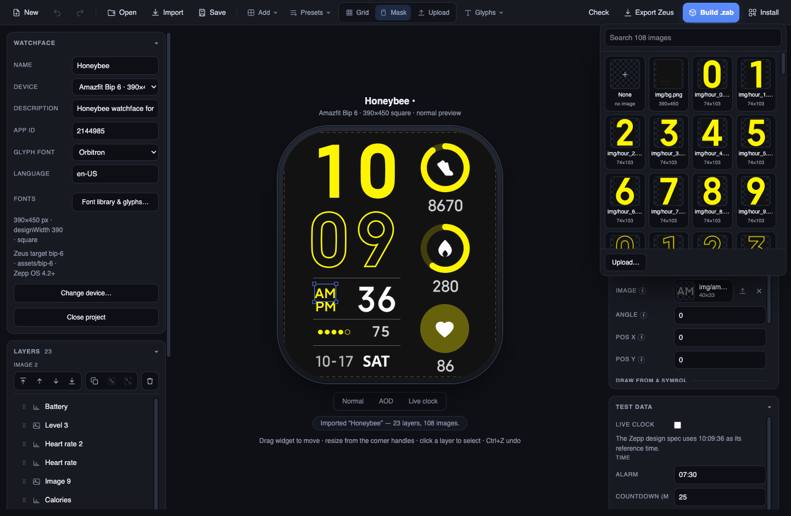 | 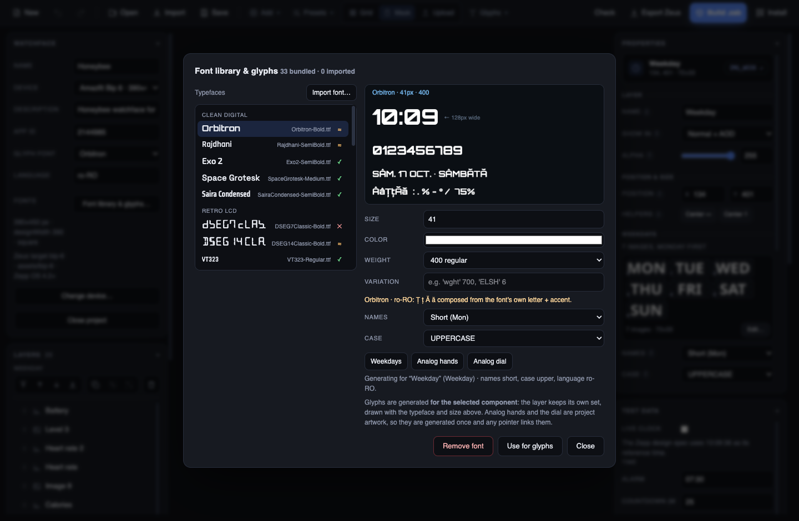 |
| **Image picker.** Every image field shows a preview; choosing opens a searchable grid of the project's images. | **Font library.** Fonts are marked ✓ / ≈ / ✕ for the project language. Here, `SÂMBĂTĂ` is drawn in Orbitron, which has no Ă. |
| 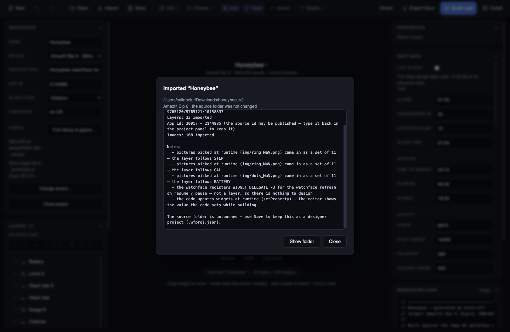 | |
| **Import report.** What came across, what was traced, and what has no designer equivalent. | |

## Sample watchfaces

The repository ships ready-made faces in [`sample-watchfaces/`](sample-watchfaces/): open the `.wfproj.json` in its `project/` folder in Dialcraft to edit it, or take the `out/` folder (a Zeus project) to build it. Each folder has a `preview.png` and a dim always-on `preview-aod.png`. A few of them:

| | | | |
| --- | --- | --- | --- |
| 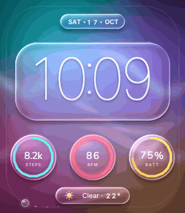 | 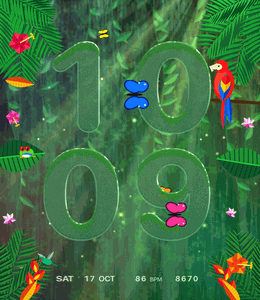 | 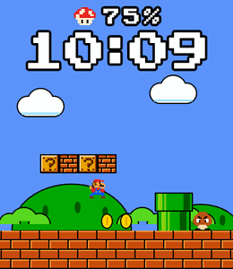 | 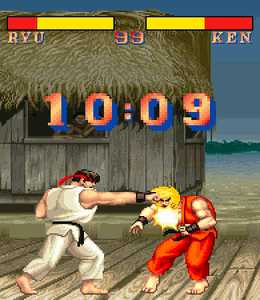 |
| **Liquid Glass**<br>Glass overlay, drifting glow, gradient rings | **Waterfall Glass**<br>Glass digits behind an animated waterfall | **Mario Live**<br>AI-played platformer, day and underground | **SF2 Demo Fight**<br>Self-playing Ryu vs Ken, with arcade HUD |
| 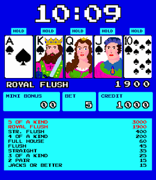 | 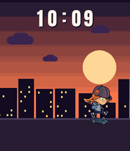 | 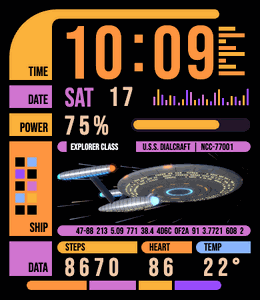 | 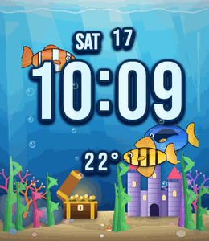 |
| **American Poker 2**<br>Self-playing video poker with double-up | **Skate Park**<br>Sprite skater doing tricks over a dusk street | **LCARS Starship**<br>3D ship and animated console panels | **Aquarium**<br>Fish and a treasure chest around the clock |
| 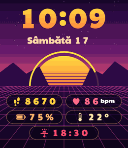 | 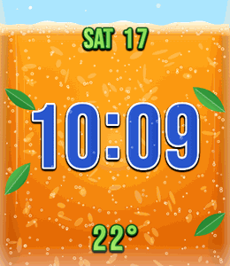 | 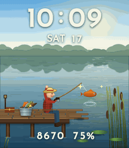 | 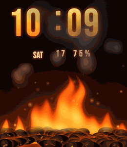 |
| **Synth Sun**<br>Retro grid with icons per reading | **Fanta Fizz**<br>Soda-glass bubbles and a date row | **Fishing Pond**<br>Self-playing fishing, the lake follows the day | **Inferno**<br>Animated flames under glowing digits |


## Getting started

### Download

Prebuilt **beta** builds are on the [Releases page](https://github.com/calinhoria/dialcraft/releases):
Windows (installer and portable `.exe`), Linux (`.AppImage` and `.deb`) and macOS
(`.dmg` / `.zip`, Apple Silicon and Intel). They are **not code-signed**, so Windows
SmartScreen and macOS Gatekeeper will warn — on macOS right-click → Open, or run
`xattr -cr /Applications/Dialcraft.app`. The app itself needs no Node, but **building
a `.zab` does** (see below).

**Updates.** The installed app checks GitHub releases a few seconds after it starts (switch it off with
*Check for updates when the app starts* in the Watchface panel, or use *Check for updates* on the start screen) and
shows a banner when a newer version exists. Nothing is downloaded without your say-so. The Windows installer and the
Linux AppImage update in place (download, then *Restart to install*); the macOS builds, the Windows portable `.exe`
and the `.deb` cannot be swapped in place, so the banner opens the release page instead. Updating arrived in 0.2.6 —
older installs have to be replaced by hand once. Updates are fetched over HTTPS from this repository's releases and
checked against the hashes in `latest*.yml`; the builds themselves are unsigned.

### From source

Requirements: **Node 18+** and npm, on macOS, Windows or Linux. Building `.zab`
packages needs Node too: the app uses a global **Zeus CLI** (`npm i -g @zeppos/zeus-cli`)
when there is one and otherwise runs `npx --yes @zeppos/zeus-cli@latest`, which needs a
network connection. The **Build tools** row in the Watchface panel shows what it found and
has an **Install Zeus** button.

```bash
git clone https://github.com/calinhoria/dialcraft.git
cd dialcraft
npm install
npm start
```

If `npm start` reports *"Electron failed to install correctly"*, npm skipped
Electron's install script. Run `npm install --foreground-scripts`.

### Your first face in a minute

1. **New** → pick your watch and the *Digital clock starter*.
2. Select the hour layer and, in **Properties → Glyph style**, change the font,
   size or fill. The digits, the colon and any `°` follow along.
3. **Presets ▾** adds weekday, date, steps, heart rate, battery, weather, arcs …
4. Select the layers that should stay on in always-on mode and click **Both** under
   *Show in* (or press `⇧B`), then check them with the **AOD** preview.
5. Press **Check**, then **Build .zab**, or **Install** to scan the QR code with
   *Zepp App → Profile → your device → Developer Mode*.

Every property in the Properties panel has an ⓘ: hover it to see what the
property does on the watch.

### Editing an existing face

**Import** a watchface `.zip`, a Zeus CLI project folder (with `app.json`,
`watchface/` and `assets/`) or a Watchface Maker export. The source folder is never modified.
**Save** writes a Dialcraft project (`<name>.wfproj.json` plus `images/` and
`fonts/`).

## Keyboard

| | |
| --- | --- |
| Undo / redo | `⌘Z` / `⌘⇧Z` (`Ctrl` on Windows/Linux) |
| Save | `⌘S` |
| Duplicate, group, ungroup | `⌘D`, `⌘G`, `⌘⇧G` |
| Bring forward / send backward | `⌘]` / `⌘[` (add `⇧` for front / back) |
| Nudge | arrow keys (`⇧` for 10 px) |
| Face variant of the selection | `⇧N` Normal · `⇧A` AOD · `⇧B` Both |
| Number fields | wheel or `↑`/`↓` on a focused field, or drag its label to scrub (`⇧` for ×10) |
| Delete | `Delete` / `Backspace` |

## Documentation

The full **[user guide](docs/GUIDE.md)** covers every widget, glyph and text
style, groups and alignment, colour themes and palettes, tap zones, AOD, export and
build, Wi-Fi install, importing, and the project format. The
**[widget coverage report](docs/ZEPP_COVERAGE.md)** compares the editor with the Zepp
widget documentation.

Zepp OS references: [watchface API](https://docs.zepp.com/docs/watchface/) ·
[widgets](https://docs.zepp.com/docs/watchface/api/hmUI/widget/) ·
[design specification](https://docs.zepp.com/docs/watchface/specification/) ·
[Zeus CLI](https://docs.zepp.com/docs/guides/tools/zeus-cli/)

## Create a face from a description (Claude Code skill)

The repository ships a [Claude Code](https://claude.com/claude-code) skill,
`.claude/skills/create-amazfit-watchface/`. Ask Claude for "a minimal green digital watchface for the
Bip 6 with steps and heart rate" and it writes a JSON *recipe*, runs it through the real editor offscreen
(`tools/face-cli.js`), looks at the preview, fixes overlaps and AOD, and exports the Zeus project (or the
`.zab`). The same driver works from the shell:

```bash
env -u ELECTRON_RUN_AS_NODE node_modules/.bin/electron tools/face-cli.js recipe.json
```

See the skill's `references/recipe.md` for the recipe format and `examples/neon-pulse.json` for a working one.

## Development

| Script | What it does |
| --- | --- |
| `npm start` | Run the app |
| `npm run css` | Rebuild `styles.css` from `styles-src.css` (Tailwind v4) |
| `npm run smoke` | (run it as `env -u ELECTRON_RUN_AS_NODE npm run smoke` if your shell sets that variable) End-to-end test: drives the app through new face → presets → code → save → export → import → fonts → `zeus build` → LAN install (`SMOKE_BUILD=0` skips the CLI build) |
| `npm run dist` | Package with electron-builder (`dist-mac` / `dist-win` / `dist-linux`) |
| release | Push a tag `vX.Y.Z` (matching `package.json`): `.github/workflows/release.yml` builds Windows, Linux and macOS and attaches them to a pre-release |
| `npm run icon` | Render `build/icon.png` / `build/icon.icns` |
| `npm run masks` | Regenerate the device display masks |
| `npm run sample` | Regenerate `samples/sample-digital/` |
| `python3 tools/fonts-latin-ext.py` | Rebuild the bundled fonts with Latin Extended coverage (needs `fonttools`) |
| `node_modules/.bin/electron tools/shot.js` | Scripted UI screenshots (used for this README) |

```
main.js        Electron main process: dialogs, save / export / build / install IPC
renderer.js    the editor: model, canvas, panels, glyph engine, import and install UI
core/          codegen, importer, device catalog, widget kinds, data types, fonts, LAN server
assets/        bundled fonts (OFL) and device masks
tools/         smoke test, screenshots, icon, masks, sample, font rebuild
docs/          user guide and screenshots
```

## Notes

- Dialcraft is an independent project. It is not affiliated with or endorsed by
  Zepp Health; *Amazfit* and *Zepp* are their trademarks.
- The bundled fonts are under the SIL Open Font License; see
  [`assets/fonts/FONTS.md`](assets/fonts/FONTS.md). The licence file is copied
  into every export that ships one of them.
- The Honeybee face in the screenshots is used as an example of importing an
  existing Zepp OS project.
